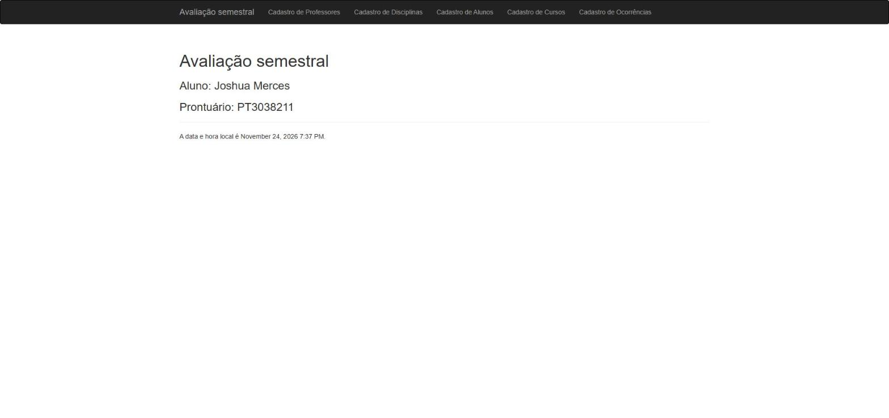

# Avaliação final — PTBDSWS

Aplicação web em Flask hospedada no PythonAnywhere: https://joshmerces.pythonanywhere.com/

- Rota principal (`/`): nome, prontuário e data/hora local (Flask-Moment).
- Rota `/disciplinas`: formulário (Flask-WTF) para cadastrar disciplina e semestre, gravados em SQLite (Flask-SQLAlchemy / Flask-Migrate) e listados em tabela.
- Módulos não desenvolvidos (`/professores`, `/alunos`, `/cursos`, `/ocorrencias`): página "Não disponível".
- Tratamento de erros 404 e 500, templates com herança e Flask-Bootstrap.

## Tela inicial



## Como executar

```bash
python3 -m venv venv
source venv/bin/activate
pip install -r requirements.txt
export FLASK_APP=flasky.py
flask db upgrade
flask run
```
